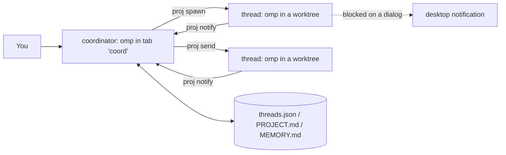

# omp-session-orchestrator

[Claude Code Projects](https://code.claude.com/docs/en/claude-projects)-style orchestration for
[oh-my-pi (omp)](https://github.com/can1357/oh-my-pi) sessions, running locally on
[herdr](https://herdr.dev).

You talk to one long-running **coordinator** session. It turns a stream of tasks into **threads**:
each thread is a full omp session in its own herdr tab, and code threads get their own git worktree
on branch `proj/<thread>`. Threads report back to the coordinator when they finish a turn. Follow-ups
go to the thread already working in that area, and project instructions and memory are set once for
all threads.



## How it differs from subagents

| | omp `task` subagent | thread |
|---|---|---|
| lifetime | one parent turn (parked after idle) | as long as the project |
| who starts it | the agent, inside one task | the coordinator, for each task you send |
| visible to you | Agent Hub of the parent session | its own herdr tab you can switch to and type in |
| follow-ups | new spawn or revive | routed to the existing thread, session resumed |
| isolation | optional | a git worktree per code thread |

## Requirements

- Linux, [herdr](https://herdr.dev) ≥ 0.8 with the omp integration (`herdr integration install omp`)
- [omp](https://github.com/can1357/oh-my-pi)
- `bash`, `jq`, `git`, `flock` (util-linux), `notify-send` (libnotify)
- optional: `gh` for pull request status

All commands must run inside herdr (`HERDR_ENV=1`).

## Install

```sh
git clone https://github.com/ivanvan08/omp-session-orchestrator ~/omp-session-orchestrator
~/omp-session-orchestrator/install.sh
```

This symlinks `bin/proj` into `~/.local/bin` and the `project-coordinator` skill into
`~/.omp/agent/skills`, then links the herdr plugin. Override the targets with `BIN_DIR` and
`OMP_SKILLS_DIR`.

## Use

```sh
proj init payments --goal "Hold p95 latency under 200 ms" --repo ~/src/payments-api
```

This creates the herdr workspace `proj:payments` with a `coord` tab running the coordinator. Talk to
the coordinator there: paste bug reports, lists of tasks, follow-ups, "remember X", "status". It
starts and routes threads with the CLI below. You can also open any thread's tab and steer it directly.

| Command | What it does |
|---|---|
| `proj init <p> [--goal T] [--repo PATH]...` | create the project and start its coordinator |
| `proj open <p>` | recreate the workspace or coordinator after a herdr restart (resumes the session) |
| `proj list` | list projects |
| `proj spawn <p> <t> [--repo PATH \| --no-repo] [--base REF] [--model M] [--task T]` | start a thread; task text from `--task` or stdin |
| `proj send <p> <t> [--task T]` | follow-up to a thread; revives it if its tab is closed |
| `proj status <p> [--json]` | threads grouped as waiting-on-you, ready-for-review, working, idle, landed, offline, resolved |
| `proj report <p> <t>` | the thread's last notify summary and final message |
| `proj notify <p> <t> <done\|blocked\|needs-input> <summary>` | thread → coordinator report (run by threads) |
| `proj remember <p> <text>` | append to the project's `MEMORY.md` |
| `proj resolve <p> <t> [--close] [--remove-worktree]` | mark a thread resolved |

State lives in `$PROJ_ROOT/<project>/` (default `~/meta/projects/`):

- `PROJECT.md`: goal, repositories, instructions every thread follows, coordinator preferences. Edit freely.
- `MEMORY.md`: requirements, decisions and pitfalls; threads read it on start.
- `threads.json`: registry (workspace, panes, worktrees, branches, last status). Written only by `proj`.
- `tasks/<thread>-<n>.md`: every task delivered to a thread.

## Resources and notifications

- A thread's tab closes by itself once it reports `done` and its turn ends, so finished threads hold
  no process. `proj send` resumes the same session in a new tab. Set `PROJ_KEEP_TABS=1` to keep tabs.
- Closing the coordinator tab is fine too: the next `proj notify` or `proj open` resumes it.
- The herdr plugin in `herdr-plugin/` replaces herdr's built-in toast and sound. In `proj:*`
  workspaces it notifies **only** when a session is blocked on a dialog that you have to answer.
  Finished turns stay silent: threads report to the coordinator, and the coordinator asks you through
  omp's `ask` tool when it needs a decision. Other panes keep herdr's behavior: notify on done and
  blocked outside the focused tab, with herdr's own `done`/`request` sounds (bundled in
  `herdr-plugin/sounds`, Apache-2.0, see `NOTICE`). Settings go in
  `$(herdr plugin config-dir omp-session-orchestrator.notify)/config.env`: `PROJ_NOTIFY_SOUND=0`
  mutes sounds, `PROJ_NOTIFY_DEBUG=1` logs decisions.

herdr's own toasts and sounds can't be filtered per pane, so turn them off when you use the plugin:

```toml
# ~/.config/herdr/config.toml
[ui.toast]
delivery = "off"

[ui.sound]
enabled = false
```

## What it does not do (compared with Claude Projects)

- No cloud: threads run on your machine and stop when it sleeps.
- No pull request watching or CI auto-fix: `proj status` shows PR state, and the coordinator acts only
  when you ask.
- Routing is done by the coordinator model following the skill, not by a separate service.

## License

MIT
